# ITU LMS: Architecture and Data Flow

This document shows how the ITU Learning Management System is put together: the parts of the system, how data moves between them, what each role can do, and how the code is organised. Each diagram is written in Mermaid, so it renders directly on GitHub and in VS Code.

**Live site:** https://itu-lms-web.onrender.com
**API:** https://itu-lms-api.onrender.com

---

## 1. System overview

The browser loads a React single-page app. Every piece of data comes from a FastAPI backend, which reads and writes a PostgreSQL database and sends account emails through Brevo.

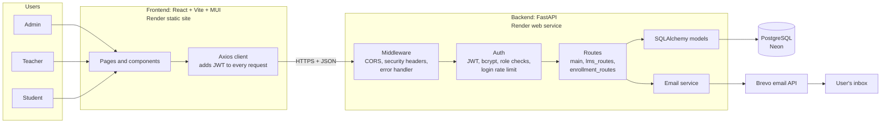

---

## 2. How one request flows

This example follows a student opening their portal. Every protected page works the same way: the token is checked, the role is checked, and only then is the database queried.

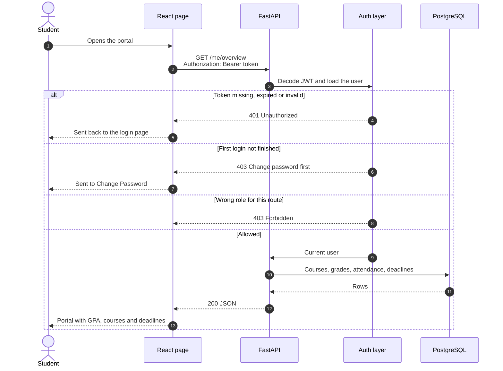

---

## 3. Account and login flow

The admin creates every account. A temporary password is emailed to the person, and they must replace it the first time they sign in.

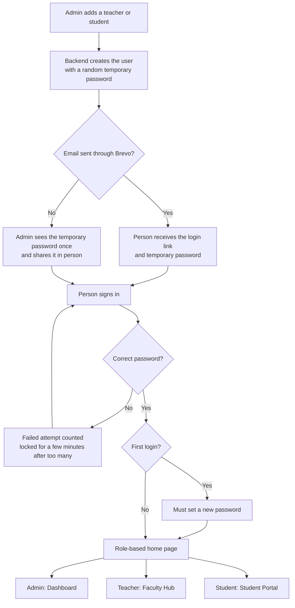

---

## 4. Course request and approval flow

Students choose the courses they want, and an admin approves or rejects each request. A student only gets access to a course's content after approval.

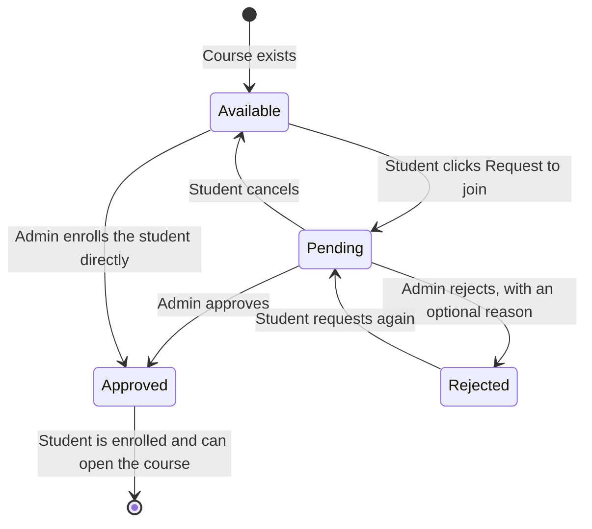

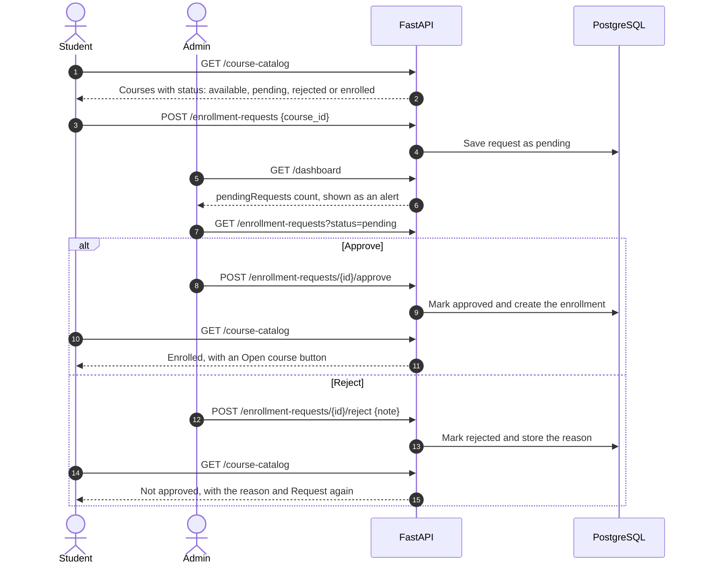

---

## 5. Coursework flow

This is the teaching cycle inside a course, from posting an assignment to the student's GPA.

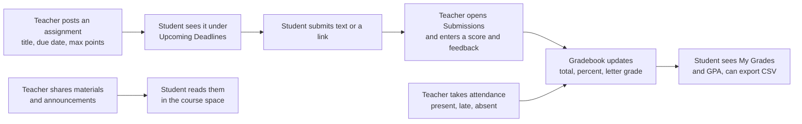

---

## 6. Features by role

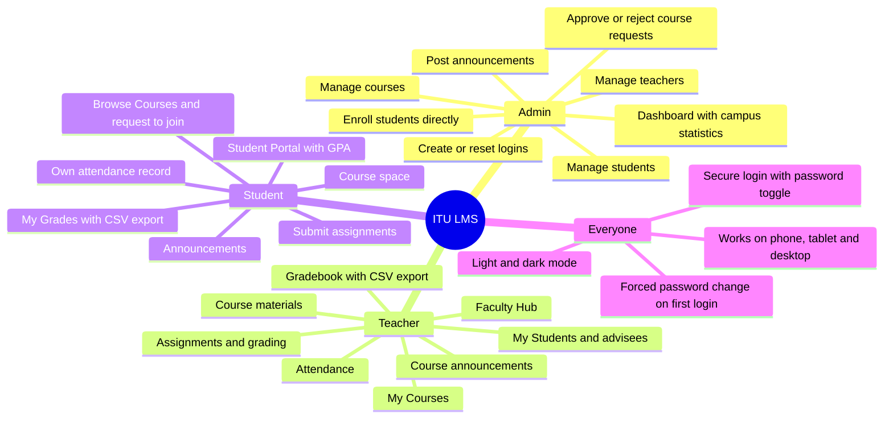

---

## 7. Modules

### Backend

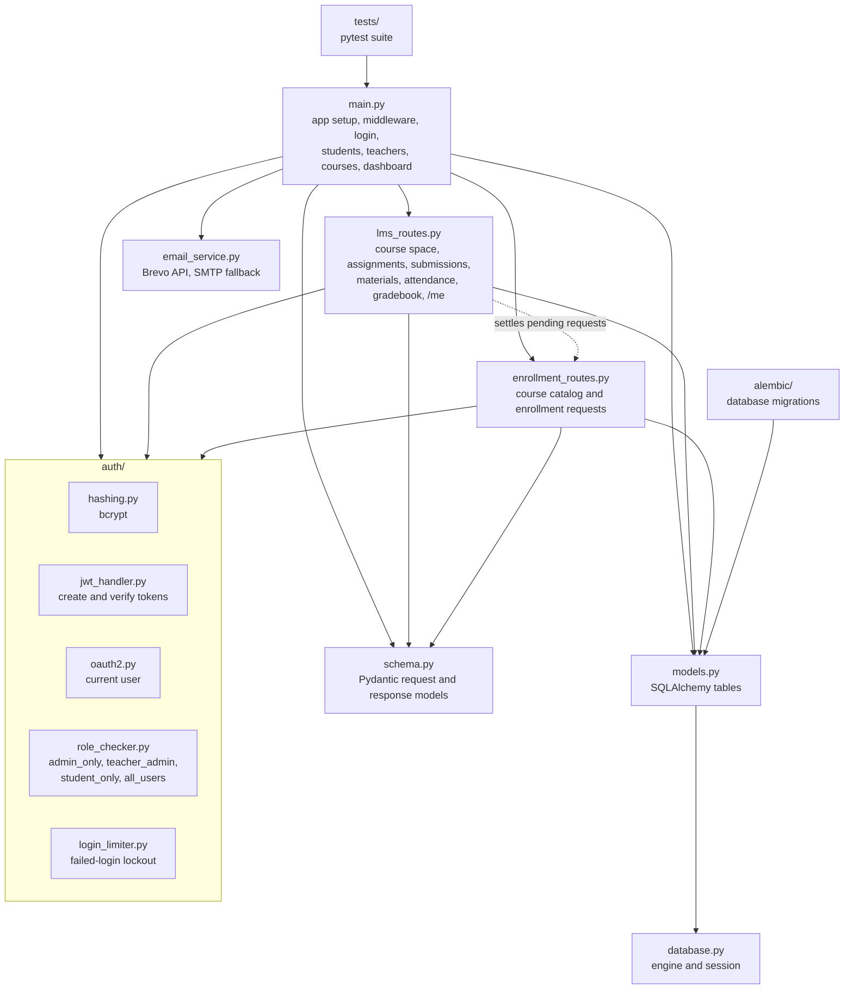

### Frontend

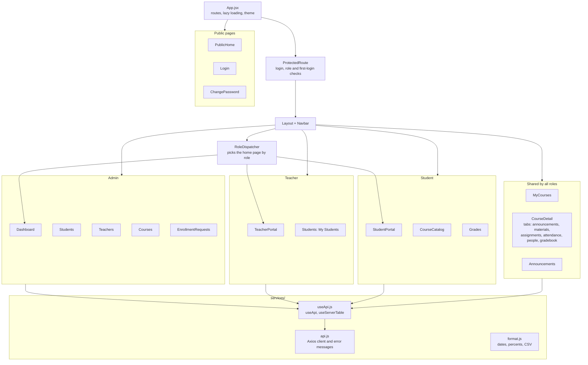

---

## 8. Database

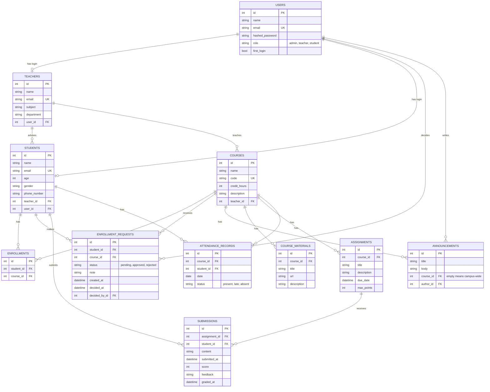

---

## 9. Build and deployment

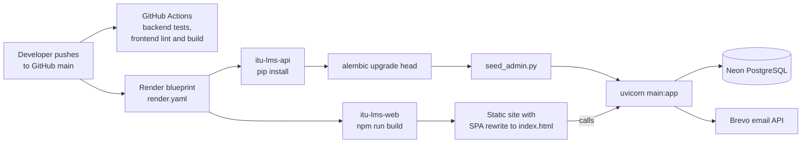
